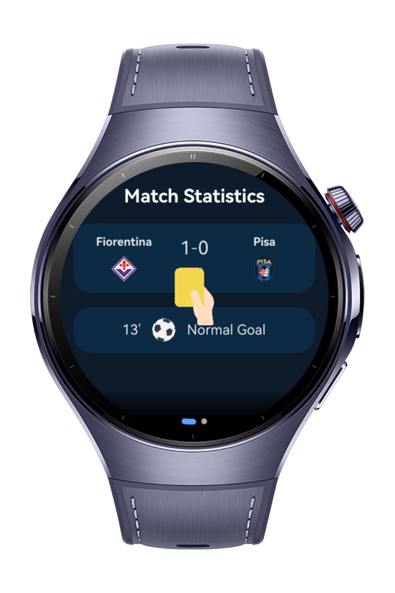
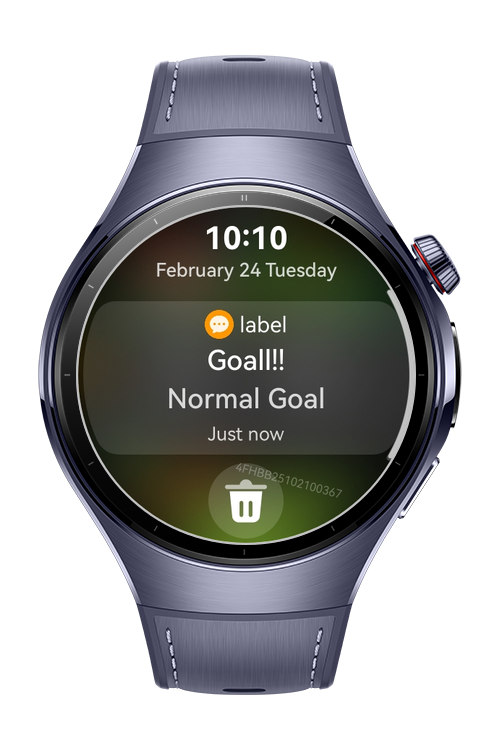
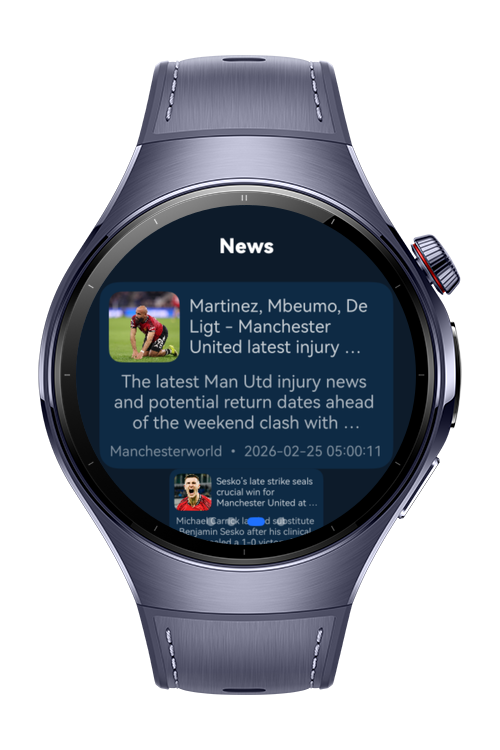

> **Note:** To access all shared projects, get information about environment setup, and view other guides, please visit [Explore-In-HMOS-Wearable Index](https://github.com/Explore-In-HMOS-Wearable/hmos-index).

# GoalPulse
Goal Pulse is a HarmonyOS Next wearable app designed to deliver an immersive football companion experience on the wrist. At onboarding, users select their favorite team, and the app provides real-time match data including live scores, upcoming fixtures, and key match events fetched from a live sports API. With Notification Kit integration, users receive instant alerts for goals, match starts, and final results, while smooth animations enhance the excitement of following matches directly on the wearable interface.

# Preview

<div>
  
  
  
  

</div>

# Use Cases

* Select a favorite team during onboarding to personalize match data.

* View live scores and real-time match events fetched from a sports API.

* Check upcoming fixtures and match schedules for the selected team.

* Receive instant notifications for goals, kick-off, and full-time events via Notification Kit.

* Track match progress with dynamic timelines and animated live indicators.

* Navigate between live match details, fixtures list, and team overview pages.

* Experience engaging animations during key match moments (goal, halftime, final whistle).

# Technology

## Stack
**Languages**: ArkTS

**Frameworks**: HarmonyOS SDK 5.1.0(18)

**Tools**: DevEco Studio Vers 5.1.0.842

**Libraries**:
`@kit.AbilityKit`, `@kit.NotificationKit`, `@kit.BasicServicesKit`, `@kit.PerformanceAnalysisKit`, `@kit.CoreFileKit`,
`@kit.ArkData`, `@kit.RemoteCommunicationKit`, `@kit.BackgroundTasksKit`

## Required Permissions
* `"ohos.permission.INTERNET"`
* `"ohos.permission.PUBLISH_AGENT_REMINDER"`
* `"ohos.permission.GET_NETWORK_INFO"`

# Directory Structure
```
 entry/src/main/ets/
├── abilities/
│   ├── EntryAbility.ets                 # Main entry ability of the wearable app
│   └── EntryBackupAbility.ets           # Backup ability for restore scenarios
│
├── model/
│   └── (models)/                        # Data models for matches, teams, fixtures, statistics
│
├── pages/
│   ├── SplashPage.ets                   # Splash screen with initial loading & routing
│   ├── LoginPage.ets                    # User login / authentication page
│   ├── OnboardingPage.ets               # Favorite team selection & first-time setup
│   ├── DashboardPage.ets                # Main hub showing selected team overview
│   ├── LivePage.ets                     # Live match screen with real-time events
│   ├── MatchStatisticsPage.ets          # Detailed match statistics and analytics
│   ├── FixturePage.ets                  # Upcoming and past fixtures list
│   ├── FavoritePage.ets                 # Favorite team management page
│   ├── ProfilePage.ets                  # User profile and preferences page
│   └── Index.ets                        # Root entry page for navigation setup
│
├── repository/
│   └── AppRepository.ets                # Central data source handling API & cache logic
│
├── services/
│   ├── NavigationService.ets            # Handles navigation between pages
│   ├── NotificationService.ets          # Manages Notification Kit events (goal, kickoff, etc.)
│   ├── PreferencesService.ets           # Local storage for user & team preferences
│   └── RcpService.ets                   # Remote configuration / API communication service
│
├── components/
│   └── (common components)              # Reusable UI components (animations, match cards, selectors)
│
├── utils/
│   └── (utilities)                      # Helper utilities for formatting, timers, and match state handling
│
├── viewmodels/
│   ├── AuthViewModel.ets                # Handles login and authentication state
│   ├── FavoriteViewModel.ets            # Manages favorite team selection & updates
│   ├── FixtureViewModel.ets             # Business logic for fixtures and schedules
│   ├── LiveMatchViewModel.ets           # Real-time live match data & animations logic
│   ├── MatchNotificationViewModel.ets   # Goal and match event notification handling
│   ├── MatchStatisticsViewModel.ets     # Provides statistics data for matches
│   ├── NotificationViewModel.ets        # Global notification state management
│   ├── OnboardingViewModel.ets          # Onboarding flow & team selection logic
│   └── SplashViewModel.ets              # Initialization and routing decisions on app start

```

# Constraints and Restrictions

## Supported Device
- Huawei Watch 5

## Limitations
- API keys are required to retrieve data from the https://newsdata.io/ and https://www.api-football.com/. 
- Register on the websites to obtain API keys, then place them in the relevant fields in RcpService and AppRepository.

- **Note : Before using the 2 APIs, the models may need to be updated based on the responses received from the endpoints. Please check.**
# License

GoalPulse is distributed under the terms of the MIT License.

See the [LICENSE](/LICENSE) for more information.